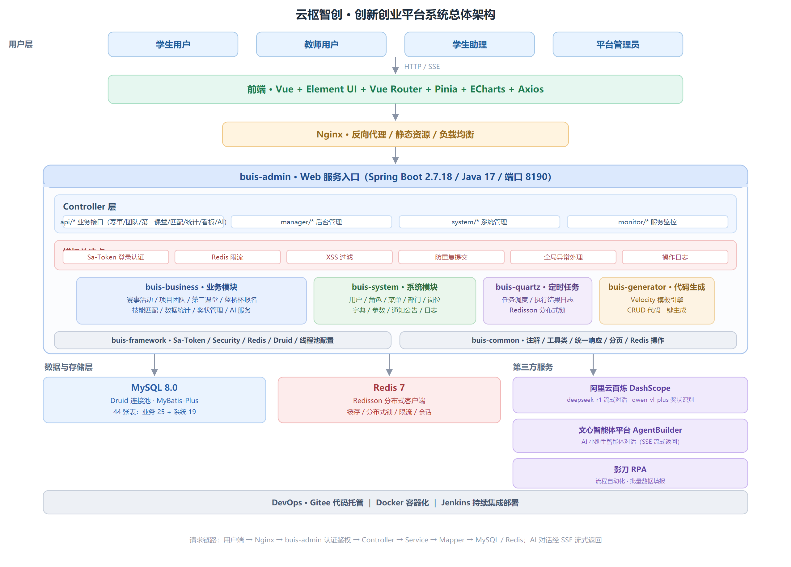
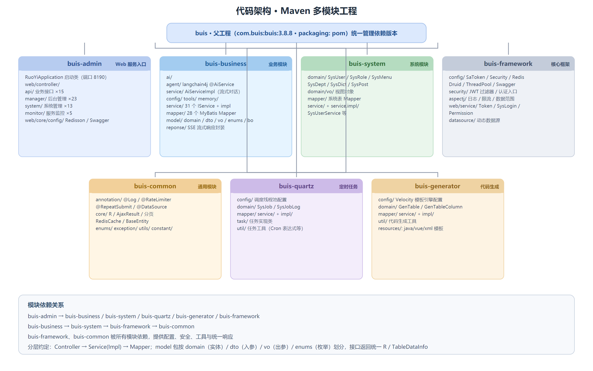
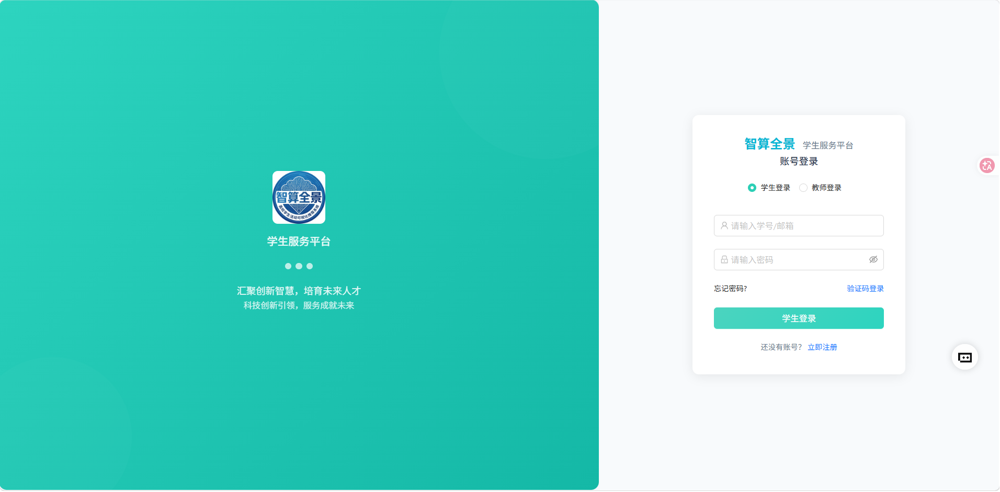
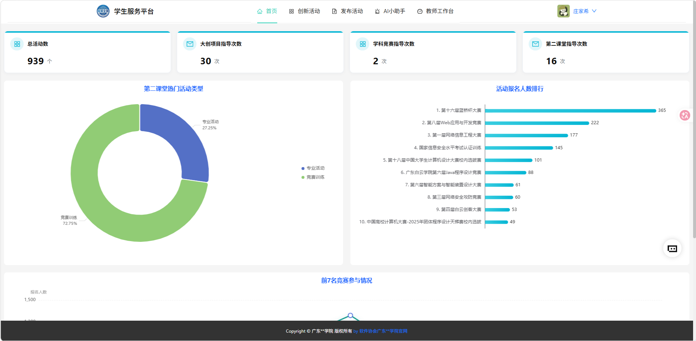
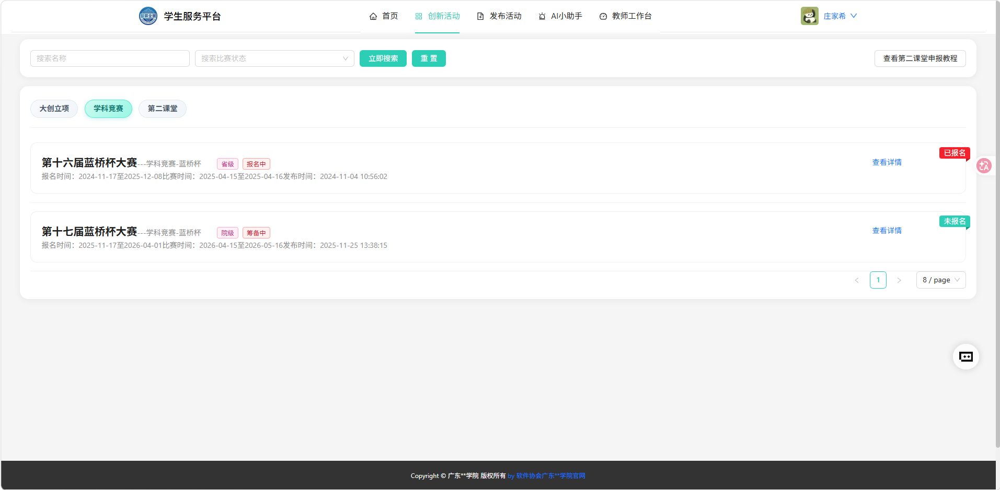
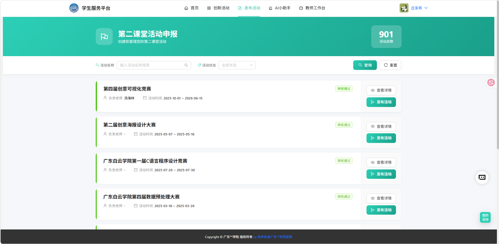
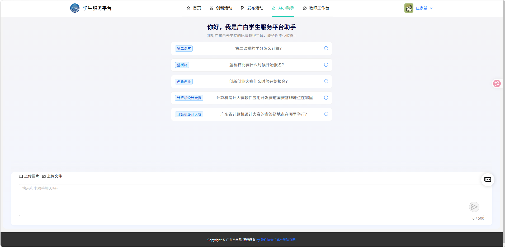

<div align="center">

# 云枢智创 · 创新创业平台

**学科竞赛 / 大创项目 / 第二课堂一体化管理系统** · 广东白云学院


</div>

## 项目介绍

学院里的学科竞赛、大创项目、第二课堂活动原来分散在几张 Excel 和不同老师手里：报名靠群接龙，材料靠网盘传，获奖信息靠手工录入，一到学期末统计口径还对不上。这个平台把这三条线归拢到一套系统里，让数据从报名到获奖沉淀在同一个库里。

平台后端以 [RuoYi](https://gitee.com/y_project/RuoYi) 3.8.8 为底子做了业务重构，重写为多模块工程（`com.buis`），并接入了几个真正在用的 AI 能力：

- **AI 小助手**：接入 DeepSeek-R1 与文心智能体平台，SSE 流式输出，回答平台使用和报名数据类问题，每用户独立限流；
- **奖状拍照识别**：上传奖状照片，调用 qwen-vl-plus 多模态模型，按约定格式提取活动名称、比赛全称、获奖级别、获奖成员、指导老师、获奖时间，前端确认后入库，不用手工敲；
- **AI 技能标签与智能组队**：从文本中提取技能标签（AI 提取失败时降级为关键词匹配），按匹配度给学生推荐队伍、给队伍推荐学生；
- **个人数据看板**：成长曲线、能力标签、获奖档案、成长时间轴，数据从业务表实时汇总。

平台已在学校实际投入使用，支撑了 2 项专业竞赛的校内报名选拔、2025 年度学院大学生创新创业项目报名，以及 2024-2025 学年第二课堂项目申报和统计工作。

## 功能特性

**学生端**

- 浏览学科竞赛 / 大创 / 第二课堂活动，按类型、级别、状态筛选并报名
- 创建项目团队，邀请或申请加入，负责人转让、退出、解散
- 维护个人技能标签，查看系统推荐的队伍与匹配度，发起入队申请
- 上传奖状，AI 识别后提交获奖信息
- AI 小助手问答，个人数据看板与成长报告导出

**教师端**

- 发布活动、配置活动规则与类型
- 预报名管理、指导学生队伍
- 查看个人指导项目数与竞赛参与统计

**学生助理**

- 审核学生提交的报名材料，录入获奖信息

**管理端**

- 用户、角色、菜单、部门、岗位、字典、参数管理（RBAC + 数据范围权限）
- 活动管理、评委管理、奖状信息汇总与数据导出
- 报名人数、学院分布、年级占比、教师指导等多维统计
- 定时任务、操作日志、登录日志、在线用户监控、服务与缓存监控
- 代码生成器，一键生成前后端 CRUD 代码

## 技术栈

| 分类 | 技术 | 说明 |
| --- | --- | --- |
| 基础框架 | Spring Boot 2.7.18 | Java 17 |
| 安全认证 | Sa-Token + JWT | 登录认证、Redis 分布式会话 |
| ORM | MyBatis-Plus 3.5.1 + PageHelper | 单表 CRUD 与分页 |
| 连接池 | Druid 1.2.23 | 主从多数据源 |
| 缓存 | Redis 7 + Redisson | 缓存、分布式锁、接口限流 |
| 定时任务 | Quartz | `buis-quartz` 模块，数据库持久化 |
| 数据库 | MySQL 8.0 | 库名 `ruoyi_race` |
| 文件存储 | 阿里云 OSS | 奖状图片、申报材料 |
| 大模型 | 阿里云百炼 DashScope | `deepseek-r1` 流式对话、`qwen-vl-plus` 图像识别 |
| 大模型 | langchain4j 0.36.2 + community-dashscope | 声明式 AI 服务，`qwen-max` / `text-embedding-v3` |
| 大模型 | 文心智能体平台 | AgentBuilder 智能体对话 |
| 接口文档 | Swagger 3 | springfox |
| 工具库 | POI / Velocity / Kaptcha / fastjson2 | Excel 导出 / 代码生成模板 / 验证码 / JSON |
| 前端 | Vue 3 + Element Plus + Pinia + ECharts + Axios | 独立工程，Nginx 部署 |
| DevOps | Gitee / Docker / Jenkins | 代码托管、容器化、持续集成 |


## 项目架构



请求从上到下经过五层：

1. **接入层**：Nginx 负责反向代理、静态资源和负载均衡；
2. **入口层**：`buis-admin` 统一暴露接口，Controller 按 `api/*`（业务）、`manager/*`（后台）、`system/*`（系统）、`monitor/*`（监控）分包；Sa-Token 做登录态与按钮级权限校验，Redis 限流、XSS 过滤、防重复提交在过滤器和拦截器层统一处理，不写在业务代码里；
3. **业务层**：`buis-business` 承载全部业务逻辑，AI 能力独立在 `com.buis.ai` 包下（Agent 声明式接口 + `AiServiceImpl`）；
4. **数据层**：MySQL 存业务与系统数据（共 44 张表，其中业务表 25 张），Redis 承担缓存、分布式锁、限流和会话，奖状与申报材料走阿里云 OSS；
5. **外部服务**：百炼（对话 + 视觉）、文心智能体（对话）、影刀 RPA（流程自动化）。

两条核心链路：

**AI 流式对话**：前端 EventSource 发起 SSE 请求 → `/api/ai/stream/chat/agent` → `AiServiceImpl` 先取 access_token，再用 WebClient 流式转发 → 以 `Flux<String>` 分片推回前端逐字渲染；每个用户一个限流器，防止刷接口。

**奖状识别入库**：上传奖状 → `/api/ai/imageAnalysis` → qwen-vl-plus 按提示词约定返回结构化字段 → 前端展示供用户修正 → 写入 `award` / `award_records` 表 → 供奖状汇总与统计看板消费。

## 代码架构

Maven 多模块工程，父 POM 统一管理依赖版本，模块间按依赖方向分层：



| 模块 | 职责 |
| --- | --- |
| `buis-admin` | Web 服务入口：启动类、全部 Controller、Redisson 与 Swagger 配置 |
| `buis-business` | 业务模块：赛事、团队、第二课堂、蓝桥杯报名、技能匹配、统计、看板、AI 服务 |
| `buis-system` | 系统模块：用户、角色、菜单、部门、岗位、字典、参数的 domain / mapper / service |
| `buis-framework` | 框架配置：Sa-Token、Security、Redis、Druid、线程池、AOP（日志 / 限流 / 数据范围） |
| `buis-common` | 通用能力：注解（`@Log` `@RateLimiter` `@RepeatSubmit`）、工具类、统一响应、分页、Redis 封装 |
| `buis-quartz` | 定时任务调度：任务配置、执行日志 |
| `buis-generator` | 代码生成器：Velocity 模板，生成 Java / Vue / XML 代码 |

分层约定：Controller → Service(Impl) → Mapper；`model` 包按 `domain`（实体）/ `dto`（入参）/ `vo`（出参）/ `enums`（枚举）划分，接口统一返回 `R` 或 `TableDataInfo`。

## 功能展示

以下为学生服务平台（Vue 前端）实际运行截图。管理端基于 RuoYi 提供活动、评委、奖状、统计与系统配置等后台功能。

管理端功能总览：


### 登录入口



学生端与教师端共用一套账号体系，登录时按身份分流，首页菜单与数据权限随之变化。

### 首页 · 数据概览



教师视角的首页把关键数据一次摊开：总活动数 939，大创项目指导 30 次、学科竞赛指导 2 次、第二课堂指导 16 次；左侧环形图是第二课堂热门活动类型分布，右侧是活动报名人数排行（蓝桥杯以 365 人居首），下方折线展示前 7 名竞赛的参与情况。

### 创新活动



大创立项、学科竞赛、第二课堂三类活动分类展示，可按名称与状态检索。卡片直接标注活动级别、报名状态和三个关键时间点（报名时间、比赛时间、发布时间），学生点「查看详情」进入报名页，已报名的活动右上角带状态标记。

### 发布活动



教师侧的第二课堂活动申报与发布：列表带审核状态，审核通过后可一键发布到学生端；顶部按名称和状态筛选，并统计活动总数。

### AI 小助手



平台内置助手，按第二课堂、蓝桥杯、创新创业、计算机设计大赛等场景给出常见问题入口，点击即可提问；对话区支持上传图片和文件，回答以流式方式逐字输出。

## 快速开始

### 环境要求

- JDK 17+
- Maven 3.6+
- MySQL 8.0+
- Redis 7+
- 阿里云 OSS、百炼 API Key（AI 功能需要，不配则对话与识别接口不可用）

### 1. 初始化数据库

```bash
# 创建数据库 ruoyi_race 及全部表结构
mysql -u root -p < sql/buisCreateTableSQL.sql

# 导入菜单、角色、字典、参数等基础数据（含默认管理员 admin）
mysql -u root -p ruoyi_race < sql/dataInsert.sql

# Quartz 调度表
mysql -u root -p ruoyi_race < sql/quartz.sql
```

### 2. 修改配置

编辑 `buis-admin/src/main/resources/application-dev.yml`（默认激活 test  profile，按需在 `application.yml` 中切换 `spring.profiles.active`）：

- `spring.datasource.druid.master`：数据库地址、账号、密码
- `spring.redis`：Redis 地址与密码
- `aliyun.ai`：百炼 API Key 与 base-url
- `aliyun.oss`：OSS endpoint、AccessKey、bucket
- `wenxin.app`：文心智能体 id 与密钥

### 3. 打包运行

```bash
mvn clean package -DskipTests

# 直接运行
java -jar buis-admin/target/buis-admin.jar

# 或使用部署脚本（Linux）
./ry.sh start     # 启动
./ry.sh status    # 查看状态
./ry.sh stop      # 停止
```

Windows 下可用 `bin/` 目录下的 `package.bat` / `run.bat`。

### 4. 访问

| 入口 | 地址 |
| --- | --- |
| 后端服务 | `http://localhost:8190` |
| Swagger 文档 | `http://localhost:8190/swagger-ui/` |
| 默认账号 | `admin` / `admin123` |

前端为独立工程（Vue 3 + Element Plus），开发态 `npm run dev`；生产构建后由 Nginx 托管，API 反向代理到后端 8190 端口。

## 配置说明

| 配置项 | 位置 | 说明 |
| --- | --- | --- |
| `server.port` | `application.yml` | 服务端口，默认 8190 |
| `spring.profiles.active` | `application.yml` | 环境切换：dev / test / prod |
| `sa-token` | `application.yml` | token 名称、有效期、JWT 密钥、并发登录策略 |
| `ruoyi.profile` | `application.yml` | 本地文件上传路径 |
| `langchain4j.community.dashscope` | `buis-business/src/main/resources/application.properties` | langchain4j 模型与密钥 |
| `aliyun.ai` / `aliyun.oss` | `application-*.yml` | 百炼 API Key、OSS 配置 |
| `wenxin.app` | `application-*.yml` | 文心智能体配置 |

## 目录结构

```text
buis-parent/
├── buis-admin/          # Web 服务入口（RuoYiApplication，端口 8190）
├── buis-business/       # 业务模块（AI / 赛事 / 团队 / 第二课堂 / 匹配 / 统计 / 看板）
├── buis-system/         # 系统模块（用户 / 角色 / 菜单 / 部门 / 字典）
├── buis-framework/      # 框架配置与安全、AOP
├── buis-common/         # 通用工具、注解与基础实体
├── buis-quartz/         # 定时任务调度
├── buis-generator/      # 代码生成器
├── sql/                 # 建表脚本、基础数据、Quartz 表
├── bin/                 # Windows 打包 / 清理 / 运行脚本
├── doc/                 # 部署与环境手册
├── ry.sh / ry.bat       # Linux / Windows 部署脚本
└── pom.xml              # 父工程 POM
```

## 致谢

- 后端基于 [RuoYi](https://gitee.com/y_project/RuoYi) 3.8.8 构建，感谢若依开源框架
- AI 能力来自阿里云百炼、langchain4j 社区与百度文心智能体平台

## 许可证

[MIT](./LICENSE)
