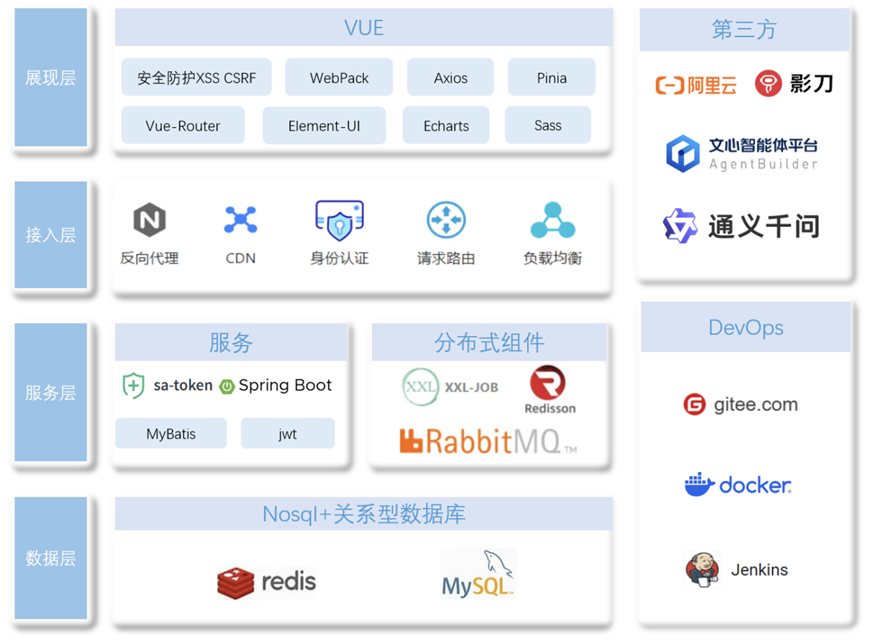
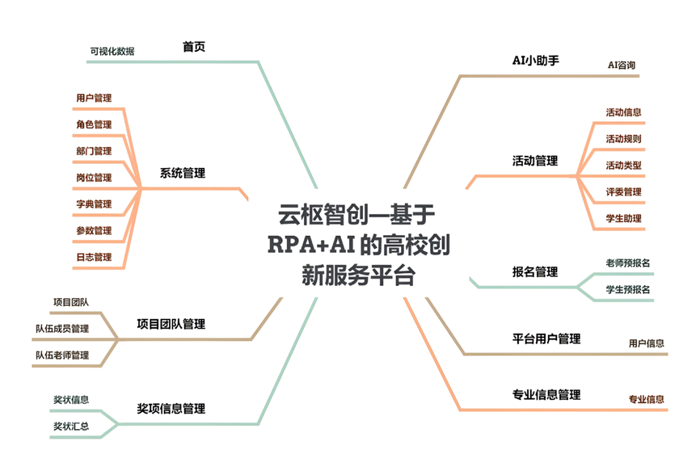

## 平台简介
本项目融合RPA流程自动化与AI智能技术，构建覆盖学科竞赛、大创项目及第二课堂的一站式智能管理平台。
创新性地加入RPA自动化、AI助手和奖状识别统计功能，实现学科竞赛、大创项目及第二课堂的智能化管理，
还可解决数据整合困难、人工操作效率低等实际工作问题。项目团队经过需求调研、架构设计、技术选型等环节，
运用多种前沿技术打造出前后端协同、功能完备的创新服务管理系统。管理员能执行系统全部功能，
包括活动规则制定、活动发布和审核、奖状识别、统计和数据导出等操作，高效统筹平台运行；
教师可发布活动、参与报名、指定队伍成员并管理项目团队，提升指导效率；
学生助理负责审核学生提交的材料，输入获奖信息，借助智能助手处理问题，保障流程规范；
学生则能查看活动详情、报名参赛、自由组队、上交材料、咨询智能助手以及管理个人信息，便捷参与各类活动。
平台打破创新活动、竞赛平台和第二课堂之间的数据孤岛，全周期实现数据采集、流程优化与决策支持，
有效提升高校双创教育效率，节约70%人力成本，为数字化转型提供轻量、可复制的解决方案。
目前该项目已经在我校投入使用，支持了2项专业竞赛的校内报名选拔、
2025 年度学院大学生创新创业项目报名以及2024-2025年度学院第二课堂项目申报和统计等工作，
其一站式流程和自动化填充功能优于传统系统，显著提高了我校师生的工作效率。

* 前端采用Vue、Element UI。
* 后端采用Spring Boot、Spring Security、Redis & Jwt。
* 权限认证使用Jwt，支持多终端认证系统。
* 支持加载动态权限菜单，多方式轻松权限控制。
* 高效率开发，使用代码生成器可以一键生成前后端代码。

##系统技术框架

##管理端功能结构

## 内置功能
1.  用户管理：用户是系统操作者，该功能主要完成系统用户配置。
2.  部门管理：配置系统组织机构（公司、部门、小组），树结构展现支持数据权限。
3.  岗位管理：配置系统用户所属担任职务。
4.  菜单管理：配置系统菜单，操作权限，按钮权限标识等。
5.  角色管理：角色菜单权限分配、设置角色按机构进行数据范围权限划分。
6.  字典管理：对系统中经常使用的一些较为固定的数据进行维护。
7.  参数管理：对系统动态配置常用参数。
8.  通知公告：系统通知公告信息发布维护。
9.  操作日志：系统正常操作日志记录和查询；系统异常信息日志记录和查询。
10. 登录日志：系统登录日志记录查询包含登录异常。
11. 在线用户：当前系统中活跃用户状态监控。
12. 定时任务：在线（添加、修改、删除)任务调度包含执行结果日志。
13. 代码生成：前后端代码的生成（java、html、xml、sql）支持CRUD下载 。
14. 系统接口：根据业务代码自动生成相关的api接口文档。
15. 服务监控：监视当前系统CPU、内存、磁盘、堆栈等相关信息。
16. 缓存监控：对系统的缓存信息查询，命令统计等。
17. 在线构建器：拖动表单元素生成相应的HTML代码。
18. 连接池监视：监视当前系统数据库连接池状态，可进行分析SQL找出系统性能瓶颈。

